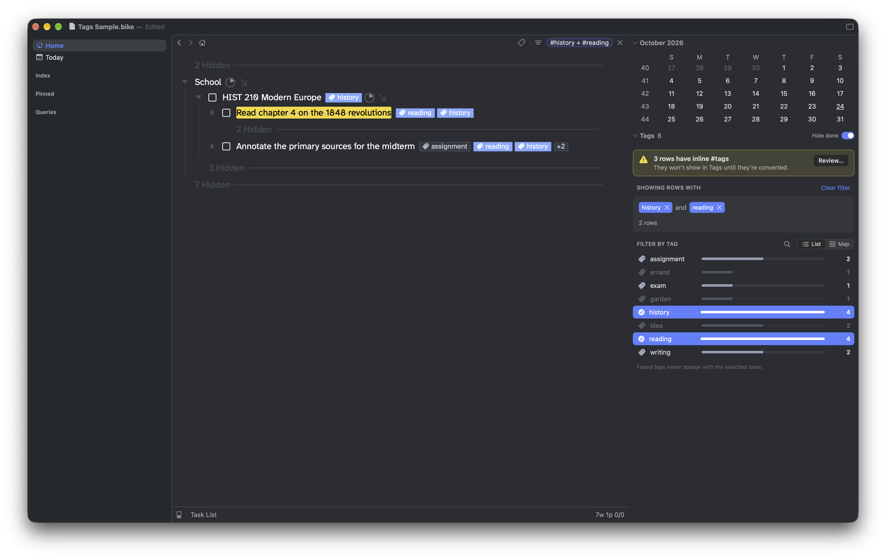

# Tags for Bike

Tags for [Bike 2](https://www.hogbaysoftware.com/bike/) that live in a row attribute instead of the row text. A row can carry several tags, each one shows as a badge after the text, and one click shows every row with that tag.

```
tag: assignment, reading, history
```

**[Download the latest release](https://github.com/biznachio/bike-tags/releases/latest)**



## What it does

- **Multiple tags per row.** A row can carry as many tags as you like, stored together in one `tag` attribute as a comma list, and each shows as its own badge.
- **Tag badges.** Each tag on a row shows as a badge with a tag symbol. Rows with more than three tags show three plus a "+2" badge. Done and canceled rows fade theirs.
- **Click a tag** to show rows with that tag, remove it from the row, rename it everywhere, or add another tag.
- **Add Tag (⌘⇧T).** Type to pick from tags you already use, or type a new one. Separate tags with commas to add several at once. Works on several selected rows too.
- **This row.** With a row selected, a card in the inspector shows its tags. Remove one with its ×, add one of your most-used tags in one click, or pick any other.
- **Filter by tag.** Click tags in the inspector to select them; the outline shows rows that have all of them. Tags that never appear with your selection fade out. A card under "Showing rows with" lists the filter and its row count. Remove a tag with its ×, or click Clear filter.
- **Find a tag.** Click the magnifier beside List and Map, or press ⌘F in the panel. As you type, the field fills in your most-used matching tag. Return adds it to the filter, Tab fills it in, and Esc closes the field.
- **List or Map.** List shows each tag with a bar of its open and done rows. Map shows each tag against your busiest top-level rows, with the rest combined in one column, so you can see where it's used; click a cell to see that tag in one area.
- **Hide done.** A switch beside the Tags heading leaves done and canceled rows out of everything Tags shows: filters, counts, the map and suggestions. Rows without a status, like notes, always stay.
- **Rename everywhere.** Renaming to a tag you already use merges the two.
- **Convert inline #tags.** While `#tags` remain in your row text, a yellow notice at the top of the inspector opens the Convert window. It lists every row that has them, with a before-and-after preview. Check the rows to convert and leave the rest, like issue numbers or chat channels. You can undo it.
- **Fast on big outlines.** Tags reads your outline once, then follows only what changes, so typing and moving between rows stay quick.

## Install

1. Download `tags.bkext.zip` from the [latest release](https://github.com/biznachio/bike-tags/releases/latest) and unzip it.
2. Quit Bike.
3. Copy `tags.bkext` into Bike's Extensions folder. Settings › Extensions can reveal it.
4. Reopen Bike.

Requires Bike 2 with extension API 0.76 or later.

To try it before using your own outline, open [`sample/Tags Sample.bike`](sample/) in Bike. It has tagged rows to click and a few inline #tags to convert.

## Commands

| Command | Shortcut |
| --- | --- |
| Add Tag | ⌘⇧T |
| Remove Tag | |
| Show Tag | |
| Clear Tag Filter | |
| Rename Tag | |
| Convert Hash Tags | |

## How tags are stored

All of a row's tags sit in one `tag` attribute as a comma list. The extension keeps that list tidy: lowercase, no duplicates, separated by ", ". If you edit the attribute by hand in Bike's Attributes Editor, it settles into that form in the same undo step, and suggestions complete the tag you're typing.

Because the value is one string, Bike's plain `@tag = reading` query only finds rows whose only tag is `reading`. The extension's filter handles lists for you. For a saved search of your own, use the same shape:

```
//@tag = "reading" or @tag beginswith "reading," or @tag endswith ", reading" or @tag contains ", reading,"
```

## Theme colors

Tag colors come from the active theme, mixed from its background and text, so they suit light and dark themes without setup. To restyle tags, a theme can define any of these colors:

| Color | Used for |
| --- | --- |
| `tag-fill` | Badge background |
| `tag-stroke` | Badge border |
| `tag-text` | Tag name |
| `tag-icon` | Tag symbol |

The tag you're filtering on always uses the theme's accent color.

## Limits

- Bike's sidebar only holds entries that point to a row, so the tag list lives in the inspector.
- Bike doesn't tell extensions when a filter changes, so the extension checks a few times a second to keep the highlighted badges in step.

## Build from source

```sh
npm install
npx bike-ext build --install   # build and install into Bike
npx bike-ext test tags         # run the tests inside Bike
```

The built extension lands in `out/extensions/tags.bkext`. See the [Bike extension kit](https://github.com/bike-outliner/extension-kit) for details.

## Changes

See [CHANGELOG.md](CHANGELOG.md).

## Credits

Built with Claude. I designed and tested it.

## License

[MIT](LICENSE)
